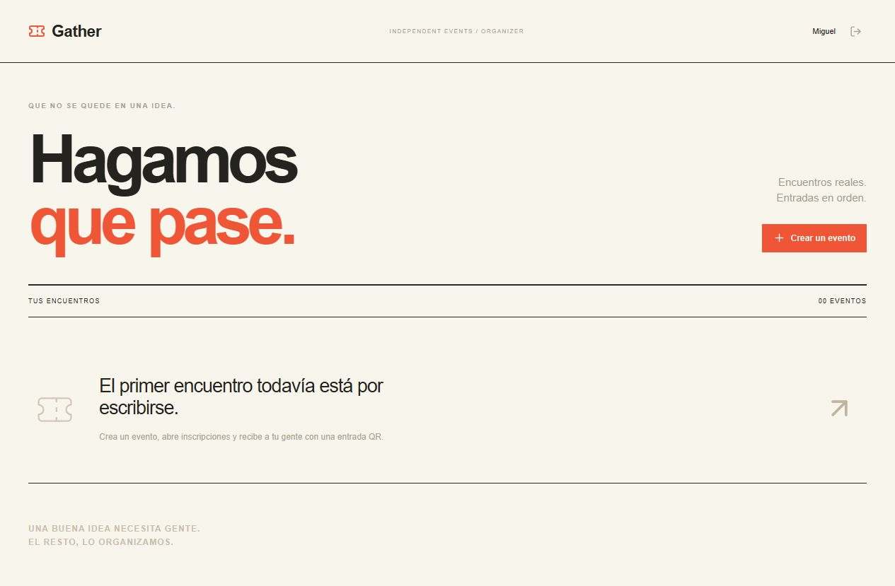

# Gather

Event registration, capacity-safe ticketing and QR check-in with duplicate-entry protection.

[](https://github.com/MIGUEL-MOSCOSO-DEV/gather/actions/workflows/ci.yml) · [Licencia MIT](LICENSE)

Organiza encuentros con una inscripción sencilla y una entrada que puedes validar en la puerta. El aforo, los asistentes y el check-in quedan en tu servidor.



## Qué puedes hacer

- Eventos con cartel propio, zona horaria, fechas, aforo y estado de publicación.
- Inscripción pública con control de capacidad y protección contra registros duplicados.
- Entradas privadas con QR, impresión o PDF y cancelación previa al inicio.
- Ingreso una sola vez, búsqueda de asistentes y exportación CSV.

## Ponerlo en marcha

Necesitas Node.js 22.13 o superior y npm. Se recomienda Node 22 LTS. SQLite viene integrado en Node; no necesitas otro servicio de base de datos.

```sh
git clone https://github.com/MIGUEL-MOSCOSO-DEV/gather.git
cd gather
npm ci
npm run dev
```

Abre http://localhost:3900 y crea tu cuenta. La instalación comienza vacía: no hay usuarios, contraseñas compartidas ni registros de demostración.

Crea el evento y publícalo para generar su enlace. Cada asistente guarda su entrada al registrarse. En el panel del evento puedes pegar el código o enlace para validar el ingreso.

## Configuración

Puedes copiar `.env.example` a `.env`. El servidor lo lee al iniciar.

- `PORT`: puerto del servidor; 3900 por defecto.
- `HOST`: interfaz de escucha; `127.0.0.1` por defecto.
- `APP_URL`: dirección pública completa para enlaces y validación del origen.
- `DATABASE_PATH`: archivo SQLite; por defecto `./data/gather.sqlite`.

Las rutas relativas parten del directorio desde el que ejecutas el proyecto. No publiques `.env` ni los datos.

## Ejecutar en un servidor

```sh
npm ci
npm run build
npm start
```

Configura `APP_URL` con tu dominio HTTPS y coloca el proceso detrás de un proxy inverso que termine TLS. Ajusta `HOST` si tu infraestructura necesita otra interfaz. Mantén Node activo con un gestor de servicios y conserva el directorio de datos entre despliegues. La base necesita almacenamiento persistente.

Las sesiones usan cookies HTTP-only y las contraseñas se almacenan con scrypt. Las rutas privadas comprueban la cuenta propietaria y hay validación de entradas y límites de solicitudes. El registro de cuentas está abierto: quien acceda al servidor puede crear su propio espacio. No incluye recuperación de contraseña por correo ni gestión de miembros.

## Datos y copias de seguridad

Detén el proceso antes de copiar la base SQLite y sus archivos asociados, o realiza una copia coherente con herramientas de SQLite. Guarda las copias fuera de la carpeta pública y comprueba su restauración. `data/`, `.env` y las dependencias están excluidos de Git.

## Alcance actual

Hasta 5000 plazas por evento. No incluye cobros ni envío de entradas por correo. La cámara requiere HTTPS o localhost y un navegador con BarcodeDetector; pegar el código siempre está disponible. El lector de cámara depende del dispositivo y no se ha probado físicamente. Una sola cuenta organiza y valida los accesos.

## Desarrollo y pruebas

```sh
npm run check
npm run format:check
npm test
npm run build
```

Aforo con solicitudes simultáneas, registros duplicados, cancelaciones, recuperación de plazas, QR e ingreso duplicado. Las pruebas crean datos temporales y los eliminan al terminar.

React construye la interfaz, Express expone la API y SQLite conserva los datos. `src/` contiene las pantallas, `server/` la lógica y persistencia, `shared/` las reglas compartidas y `tests/` las verificaciones. GitHub Actions ejecuta los controles en cada cambio de la rama principal.

## Contribuir

Abre un issue con los pasos para reproducir el error y el comportamiento esperado. No adjuntes credenciales, archivos privados ni bases de datos. Para proponer cambios, explica qué resuelven y añade pruebas cuando afecten reglas de negocio.

Creado por [Miguel Moscoso](https://github.com/MIGUEL-MOSCOSO-DEV). Licencia MIT.
